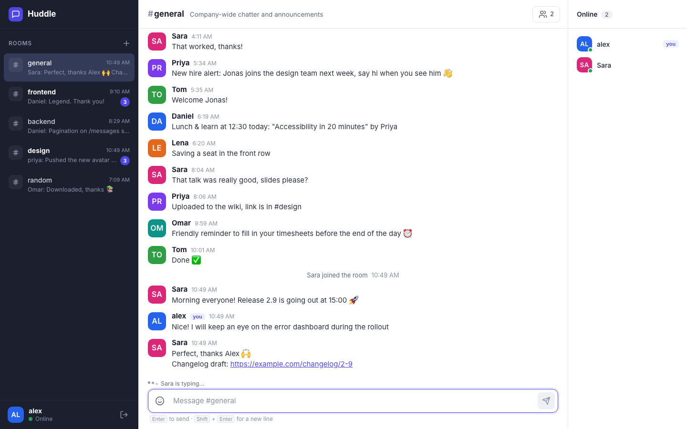
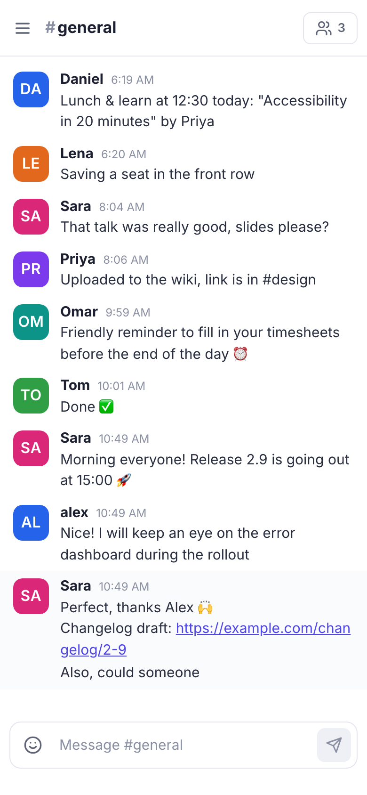
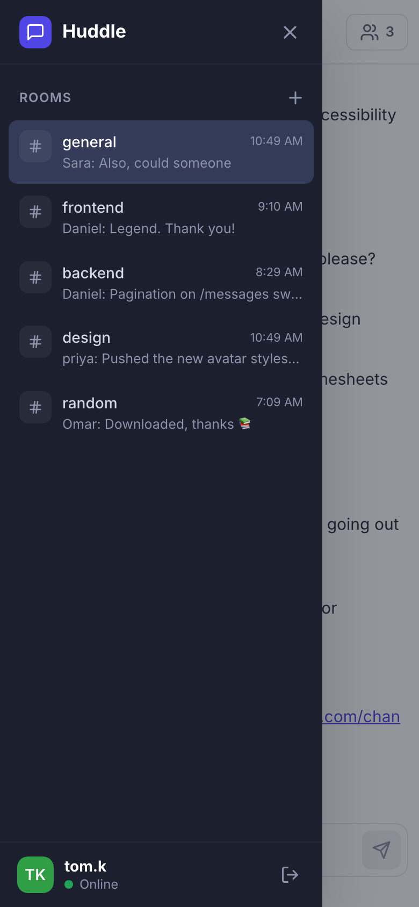

# Huddle – Realtime Chat

Team chat with rooms, live messages, presence and typing indicators, built with Angular and FastAPI WebSockets.

**Live demo:** https://hkhodkar.github.io/realtime-chat/

The demo runs fully in your browser: a mock backend answers the REST calls and simulates the socket server. Open it in two tabs to chat with yourself, and two simulated teammates (Maya and Leo) will type and reply in the room you are in.



<p>
  
  
</p>

## Features

- **Rooms** in a sidebar with last message preview, time and unread count; create a room with a validated name and an optional description
- **Join with a username** and avatar color, no password. Names are unique among people who are online (checked as you type and again by the API)
- **Live messages over a WebSocket per room**, saved in SQLite, with history loaded over REST and cursor pagination when you scroll up
- Messages **grouped by author and day**, timestamps, links turned into anchors, emoji-only messages shown bigger
- **Auto-scroll** to the newest message, unless you scrolled up to read; then a "new messages" pill appears
- **Typing indicator** ("Sara is typing…"), throttled on the sender and expiring on the receiver
- **Presence**: online list per room, join and leave notes, online counts in the room list
- **Composer**: Enter to send, Shift+Enter for a new line, emoji picker, 1000 character limit with a counter
- **Reconnects with exponential backoff** and a visible status ("Reconnecting in 4s…", retry now), catching up on missed messages afterwards
- **Responsive**: on phones the room list becomes a drawer and the online list slides in from the right

## Tech Stack

| Frontend | Backend |
| --- | --- |
| Angular 21 (standalone components, signals, zoneless, OnPush) | FastAPI with WebSocket endpoints |
| Typed reactive forms with async validation | SQLModel + SQLite |
| RxJS for the socket stream | Pydantic v2 validation |
| Custom SCSS, no UI kit | pytest with `TestClient.websocket_connect` |
| Vitest unit tests | Docker, docker compose |

## Getting Started

### With Docker

```bash
docker compose up --build
```

- App: http://localhost:8080
- API docs (Swagger UI): http://localhost:8000/docs

Demo rooms and message history are seeded on the first start.

### Locally

Backend (Python 3.12):

```bash
cd backend
python -m venv .venv && source .venv/bin/activate
pip install -r requirements-dev.txt
uvicorn app.main:app --reload        # http://localhost:8000/docs
pytest                               # REST and WebSocket tests
```

Frontend (Node 22):

```bash
cd frontend
npm install
npm start                            # http://localhost:4200, proxies /api (and websockets) to :8000
npm test -- --watch=false
```

If the backend is not running, the frontend switches to demo mode by itself and uses the in-browser mock. `npx ng build --configuration demo` builds the GitHub Pages version, where demo mode is always on.

## API

| Method | Path | Description |
| --- | --- | --- |
| `GET` | `/api/rooms` | Rooms with message count, last message and online count |
| `POST` | `/api/rooms` | Create a room (`X-Session-Token` header) |
| `GET` | `/api/rooms/{id}/messages?before=&after=&limit=` | Message history, cursor based, oldest first |
| `POST` | `/api/rooms/{id}/messages` | Post without a socket |
| `POST` | `/api/sessions` | Join with `username` and `color`, returns a token |
| `GET` | `/api/sessions/availability?username=` | Is the name free right now |
| `WS` | `/api/rooms/{id}/ws?token=` | Live room events |

Socket events from the server: `presence`, `join`, `leave`, `message`, `typing`, `room_updated`, `error`. The client sends `message` and `typing`. An unknown session closes the socket with code `4401`, an unknown room with `4404`.

## Project Structure

```
realtime-chat/
├── backend/
│   ├── app/
│   │   ├── main.py            # app factory, CORS, seeding on startup
│   │   ├── hub.py             # sessions, presence and fan-out to sockets
│   │   ├── routers/           # rooms, messages, sessions, ws
│   │   ├── models.py          # SQLModel tables
│   │   ├── schemas.py         # request/response models and validation
│   │   └── seed_data.json     # demo rooms and history
│   └── tests/                 # pytest, REST and WebSocket flows
├── frontend/
│   └── src/app/
│       ├── core/
│       │   ├── api/           # typed HTTP client
│       │   ├── chat/          # rooms store, room store, timeline grouping
│       │   ├── socket/        # reconnecting WebSocket with backoff
│       │   ├── session/       # username session, guard, interceptor
│       │   └── mock/          # demo backend: HTTP interceptor, BroadcastChannel hub, bots
│       ├── features/
│       │   ├── join/          # pick a username and color
│       │   └── chat/          # sidebar, message list, composer, online list, dialogs
│       └── shared/            # avatar, icons, demo banner, text helpers
├── docs/                      # screenshots
└── docker-compose.yml
```

## Author

Hatef Khodkar – [github.com/hkhodkar](https://github.com/hkhodkar)

## License

MIT
